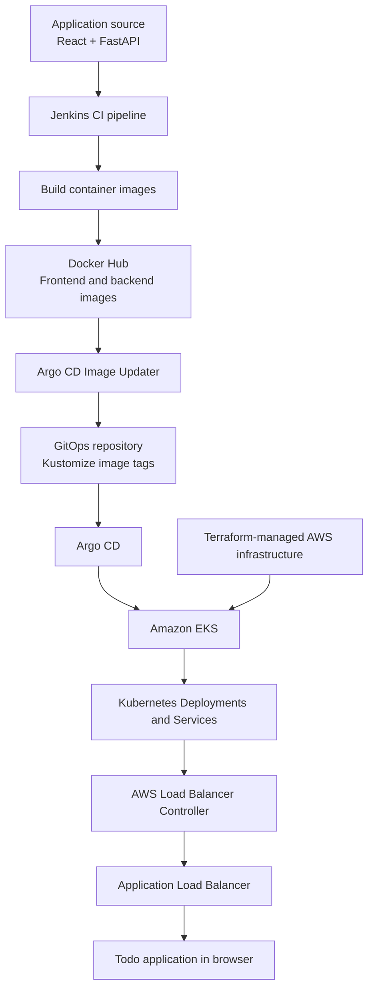
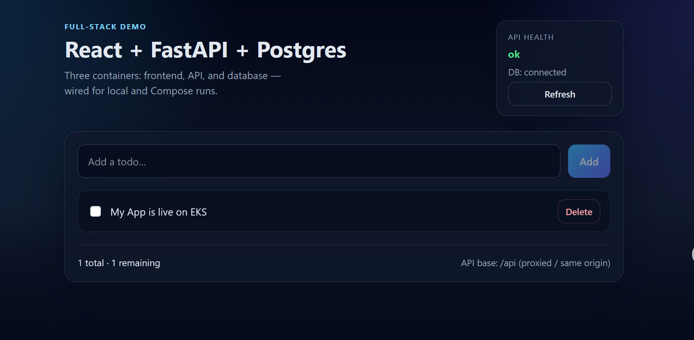
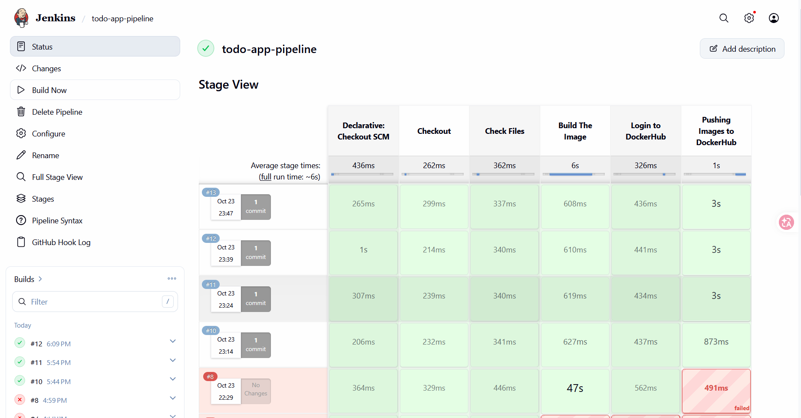
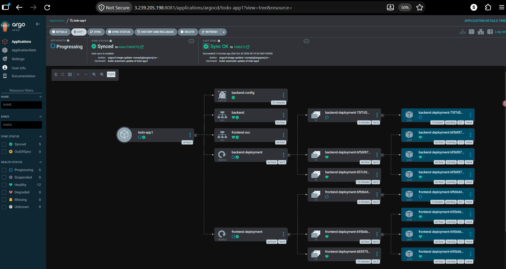

# Todo App --- CI/CD & GitOps on AWS

An end-to-end DevOps project deploying a React + FastAPI Todo application to Amazon EKS using Terraform, Jenkins, Docker Hub, Argo CD, and Argo CD Image Updater.

## Architecture

## Tech Stack

-   **Frontend:** React
-   **Backend:** FastAPI
-   **Containers:** Docker
-   **CI:** Jenkins and a Jenkins Shared Library
-   **Container Registry:** Docker Hub
-   **GitOps / CD:** Argo CD and Argo CD Image Updater
-   **Orchestration:** Kubernetes on Amazon EKS
-   **Networking:** AWS Load Balancer Controller and Application Load
    Balancer
-   **Infrastructure as Code:** Terraform

## How It Works

1.  Application source code is stored in the application repository.
2.  Jenkins checks out the code, validates required files, builds
    frontend and backend Docker images, and pushes them to Docker Hub.
3.  Argo CD Image Updater detects eligible image versions and updates
    the image tags in the GitOps configuration.
4.  Argo CD detects the Git change and synchronizes the Kubernetes
    resources in Amazon EKS.
5.  The AWS Load Balancer Controller manages the Application Load
    Balancer, which routes browser traffic to the application.

## Screenshots

### 1. Application Running

### 2. Jenkins CI Pipeline

### 3. Docker Hub Images

### 4. Argo CD Application Status

### 5. Argo CD Image Updater

### 6. Terraform State

### 7. AWS and Kubernetes Resources

## Related Repositories

-   **GitOps / Kubernetes manifests:**
    [todo-app-argo-cd](https://github.com/sakshamjp2004/todo-app-argo-cd)
-   **Application source and CI pipeline:**
    [react-fastapi-todo](https://github.com/sakshamjp2004/react-fastapi-todo)
-   **Reusable Jenkins Shared Library:**
    [todo-sharedLibrary](https://github.com/sakshamjp2004/todo-sharedLibrary)

## Key Learnings

-   Building and publishing multi-service Docker images through Jenkins.
-   Reusing pipeline logic with a Jenkins Shared Library.
-   Deploying applications to Amazon EKS.
-   Managing Kubernetes deployments through GitOps with Argo CD.
-   Automating image-tag updates with Argo CD Image Updater.
-   Exposing an application using AWS Load Balancer Controller and an
    Application Load Balancer.
-   Using Terraform to manage cloud infrastructure.

------------------------------------------------------------------------

